  <picture>
    <source media="(max-width: 600px) and (prefers-color-scheme: light)" srcset="https://raw.githubusercontent.com/SirMik3/SirMik3/main/assets/terminal-compact-light.svg" />
    <source media="(max-width: 600px)" srcset="https://raw.githubusercontent.com/SirMik3/SirMik3/main/assets/terminal-compact.svg" />
    <source media="(prefers-color-scheme: light)" srcset="https://raw.githubusercontent.com/SirMik3/SirMik3/main/assets/terminal-light.svg" />
    
  </picture>

I'm **Michael**, a systems and security developer from Cyprus. I work close to the metal: **C/C++**, **x86-64 assembly**, and **Python** for the tooling around it.

I like to take a system apart to see how it really works, and then build the tools I wish I'd had. In practice that means reading disassembly, chasing memory-corruption bugs back to their root cause, and digging into Linux internals: syscalls, the kernel, drivers and eBPF. I also spend time on network protocols, both pulling them apart and hardening the hosts that speak them.

### Focus

- **Reverse engineering** — ELF/PE internals, static and dynamic analysis, firmware
- **Exploit development** — memory corruption, mitigations and how they fail
- **Linux internals** — kernel, drivers, eBPF, the syscall boundary
- **Network security** — protocol analysis, packet capture, system hardening

---

## Tech Stack

  
  
  
  
  

  
  
  
  
  

  
  
  

  <em>currently learning</em> 

  
  

---

## Connect with Me

  
  
  

